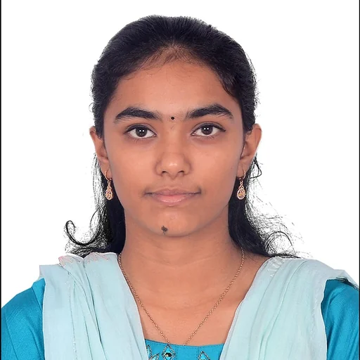
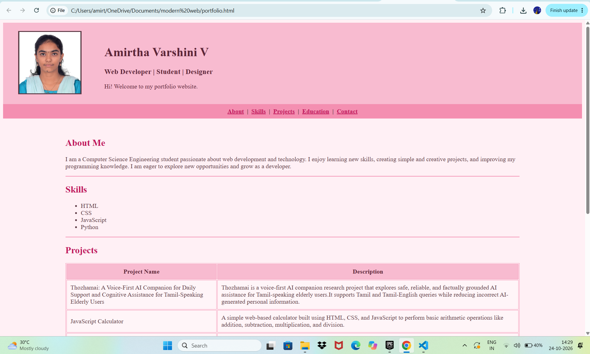

# Ex01 Portfolio
## Date:24-10-2026

## AIM
To create a Portfolio using HTML and CSS.

## ALGORITHM
### STEP 1
Create an HTML file (index.html)

### STEP 2
Create a CSS file (style.css)

### STEP 3
Include a navigation bar with links to different sections.

### STEP 4
Add structured sections for introduction, about, projects, and contact details.

### STEP 5
Define global styles for fonts, colors, and layout.

### STEP 6
Style the header, navigation bar, and sections.

### STEP 7
Use Flexbox or CSS Grid for layout design.

### STEP 8
Add hover effects and transitions for interactivity.

### STEP 9
Add Images and Media.

### STEP 10
Use optimized images for a professional look.

### STEP 11
Open the HTML file in a browser to check layout and functionality.

### STEP 12
Fix styling issues and refine content placement.

### STEP 13
Deploy the Portfolio.

### STEP 14
Upload to GitHub Pages for free hosting.

## PROGRAM
```
<!-- portfolio-dark-purple.html -->
<!DOCTYPE html>
<html lang="en">
<head>
<meta charset="UTF-8">
<meta name="viewport" content="width=device-width, initial-scale=1">
<title>My Portfolio</title>
</head>

<body bgcolor="#FFF0F5" text="#5D3A45" link="#C2185B" vlink="#AD1457" alink="#EC407A">

<table width="100%" bgcolor="#F8BBD0" cellpadding="20">
  <tr>
    <td width="200" align="center">
      
    </td>
    <td>
      <h1><font color="#5D2638">Amirtha Varshini V</font></h1>
      <h3><font color="#5D2638">Web Developer | Student | Designer</font></h3>
      <font color="#5D2638">Hi! Welcome to my portfolio website.</font>
    </td>
  </tr>
</table>

<table width="100%" bgcolor="#F48FB1" cellpadding="8">
  <tr>
    <td align="center">
      <b>
      <a href="#about">About</a> &nbsp;|&nbsp;
      <a href="#skills">Skills</a> &nbsp;|&nbsp;
      <a href="#projects">Projects</a> &nbsp;|&nbsp;
      <a href="#education">Education</a> &nbsp;|&nbsp;
      <a href="#contact">Contact</a>
      </b>
    </td>
  </tr>
</table>

<br>

<table width="80%" align="center" cellpadding="10">
  <tr>
    <td>

      <h2 id="about"><font color="#C2185B">About Me</font></h2>
      <p>I am a Computer Science Engineering student passionate about web development and technology.
         I enjoy learning new skills, creating simple and creative projects, and improving my programming knowledge.
         I am eager to explore new opportunities and grow as a developer.</p>
      <hr color="#F48FB1">

      <h2 id="skills"><font color="#C2185B">Skills</font></h2>
      <ul>
        <li>HTML</li>
        <li>CSS</li>
        <li>JavaScript</li>
        <li>Python</li>
      </ul>
      <hr color="#F48FB1">

      <h2 id="projects"><font color="#C2185B">Projects</font></h2>
      <table width="100%" border="1" cellpadding="10" bgcolor="#FFF5F8" bordercolor="#F48FB1">
        <tr bgcolor="#F8BBD0">
          <th><font color="#5D2638">Project Name</font></th>
          <th><font color="#5D2638">Description</font></th>
        </tr>
        <tr>
          <td>Thozhamai: A Voice-First AI Companion for Daily Support and Cognitive Assistance for Tamil-Speaking Elderly Users</td>
          <td>Thozhamai is a voice-first AI companion research project that explores safe, reliable, and factually grounded AI assistance for Tamil-speaking elderly users.It supports Tamil and Tamil-English queries while reducing incorrect AI-generated personal information.</td>
        </tr>
        <tr>
          <td>JavaScript Calculator</td>
          <td>A simple web-based calculator built using HTML, CSS, and JavaScript to perform basic arithmetic operations like addition, subtraction, multiplication, and division.</td>
        </tr>
        <tr>
          <td>Fantasy Restaurant Website</td>
          <td>A responsive restaurant website built using HTML and CSS to showcase food menus, prices, restaurant staff, and contact information.</td>
        </tr>
      </table>
      <br>
      <hr color="#F48FB1">

      <h2 id="education"><font color="#C2185B">Education</font></h2>
      <p><b>B.E Computer Science</b><br>Saveetha engineering college<br>2024 - 2028</p>
      <p><b>Third Year</b><br>Sri Sankara Vidyala Matricuation Higher Secondary School<br>2022 - 2024</p>
      <hr color="#F48FB1">

      <h2 id="contact"><font color="#C2185B">Contact Me</font></h2>
      <p>
        Email: <a href="mailto:amirthavarshiniv2006@gmail.com">amirthavarshiniv2006@gmail.com</a><br>
        Phone: +91 7339004089<br>
        LinkedIn: <a href="https://www.linkedin.com/in/amirtha-varshini-v-b5347b2bb" target="_blank">https://www.linkedin.com/in/amirtha-varshini-v-b5347b2bb</a><br>
        GitHub: <a href="https://github.com/AmirthaVarshini20" target="_blank">https://github.com/AmirthaVarshini20</a>
      </p>

    </td>
  </tr>
</table>

<table width="100%" bgcolor="#F8BBD0" cellpadding="10">
  <tr>
    <td align="center"><font color="#5D2638">&copy; 2026 Amirtha Varshini V. All rights reserved.</font></td>
  </tr>
</table>

</body>
</html>

```

## OUTPUT


## RESULT
The program for creating Portfolio using HTML and CSS is executed successfully.